# Yapay zekâ ekibi yönetirken öğrendiğim 7 ders, sayılarla

İki ayda yapay zekâ ajanlarından bir ekip kurdum, iki kez yıkıp yeniden kurdum. Her seferinde daha sade bir düzene döndüm. Sonra okuduğum araştırmaların da aynı yere vardığını gördüm.

Önce kim olduğumu söyleyeyim. Profesyonel yazılımcı değilim. Kodu ajanlar yazıyor, ben yönetiyorum. Bugün bu ekiple bir App Store uygulaması, bir şirket sitesi, bir AutoCAD eklentisi ve bu hesabı yöneten X asistanı üzerinde çalışıyorum.

Ekipte bir yönetici model işi böler ve karar verir. Başka modeller kod yazar, okur, inceler. Bu yazıdaki sayıların çoğunu ben ölçmedim, ajanlara ölçtürdüm. Birkaçını ikinci bir modele de kontrol ettirdim. O yüzden onları kesin sonuç olarak değil, yön gösteren sayılar olarak okuyun. Dış kaynaklar için ayrıca 32 iddiayı asıl kaynağında açtırdım. Yazıda kullandıklarımın hepsi bunların içinde. 7'si kaynakta benim notlarımdakinden farklı çıktı, 1'i hiç bulunamadı. Farklı olanları kaynaktaki hâliyle yazdım, bulunamayanı yazmadım.

Yedi derse geçmeden ekibin nasıl değiştiğini anlatayım, çünkü derslerin hepsi bu değişimden çıktı.

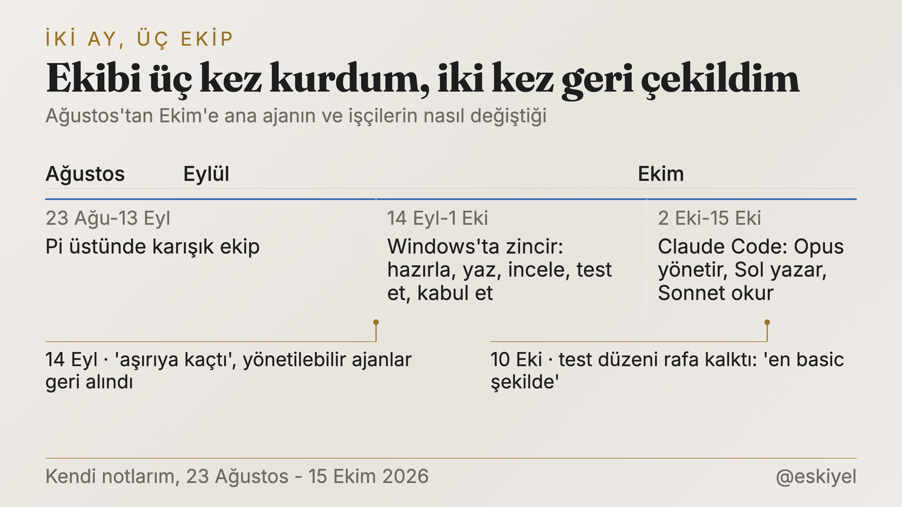
*İki ayda üç ekip kurdum, iki kez geri çekildim.*

**Ağustos.** Pi adlı bir ajan aracının üstünde, farklı şirketlerin modellerinden bir ekip kurdum. İlk iş "hangi model hangi rolde iyi" ölçümüydü. İlk şaşkınlık da orada geldi. Kod yazarken çok iyi olan model, yönetici koltuğuna oturunca işçilerin işini tek tek okumaya başladı. Kendi context'ini, yani o an aklında tuttuğu metni, başka bir modele göre tur başına yaklaşık %60 daha hızlı doldurdu. Küçük bir denemeydi, ama ilk dersi oradan aldım. İyi işçi ile iyi yönetici aynı şey değilmiş.

**Eylül.** Ajanları "yönetilebilir" yaptım: soru sorabilen, yarım kalan işini sürdürebilen, durumunu hatırlayan ajanlar. 14 Eylül'de hepsini geri aldım. O gün ajana şöyle demişim: "soru cevap falan aşırıya kaçtı ve bundan memnun değilim." Ayın geri kalanında Windows'ta bir zincir kurdum: bir model hazırlar, biri kodu yazar, biri inceler, biri test eder, biri kabul eder. Doğru çalıştı ama yavaştı.

**Ekim.** Claude Code'a geçtim. Bugün Opus yönetiyor ve karar veriyor, Codex'te Sol kodu yazıyor, Sonnet okuyor ve araştırıyor. Burada da bir kez daha şiştik ve 10 Ekim'de geri çekildik. O hikâye en sonda.

## 1. Varsayılan tek ajan, çünkü devretmenin sabit bir bedeli var

Çok ajanlı sistemler pahalı. Anthropic'in kendi ölçümüne göre tek bir ajan, sohbete göre yaklaşık 4 kat token harcıyor; çok ajanlı bir sistem yaklaşık 15 kat. Opus 5.5'in sistem kartına göre beş ajanlı bir ekip aynı puana tek ajandan 2,7 kat hızlı ulaşıyor, ama daha pahalıya. Kısa işlerde ise koordinasyon yükü yüzünden tek ajandan yavaş kalabiliyor.

Anthropic'in kendi araştırma görevinde çok ajanlı sistem tek başına çalışan Opus'u %90,2 geçmiş. Ama o iş geniş ve paralel okunabilen bir araştırma işi. Kodlama gibi sıkı bağlı işlerde kazanç çoğunlukla zamandan geliyor, paradan değil. Every ekibi Codex notlarında aynı şeyi başka türlü söylüyor. Orkestrasyonun bedelini her parça için ayrı ayrı değil, her devirde bir kez ödüyorsun. Bu da küçük işte o bedelin işin kendisinden büyük çıkması demek.

Bende bu bedelin büyüklüğünü 63 oturum üzerinden ölçtürdüm. Yönetici bir işi Codex'e verdiğinde, işin büyüklüğünden bağımsız olarak kendi context'ine medyan 7,8 bin token ekliyor. Brief'i yazıyor, raporu okuyor, sonucu kontrol ediyor. Bu sabit bedel küçük işte çok ağır, büyük işte önemsiz kalıyor.

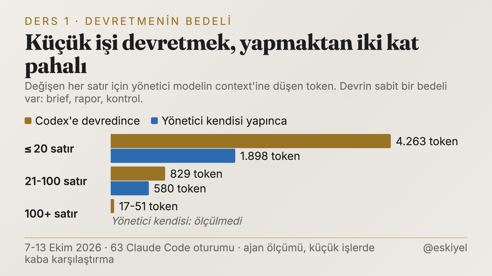
*20 satırın altındaki işte devretmek, yöneticinin kendisi yapmasının iki katından pahalı.*

20 satırın altındaki bir işi devretmek, yöneticiye kendisi yapmasının iki katından fazlasına mal oluyor. 100 satırı geçince devir satır başına 17-51 tokene iniyor. Codex içeride 50 bin token okurken yönetici 8-10 bin ödüyor. Küçük işlerdeki karşılaştırma kaba, örnek sayısı az. Ama yön açık. Bugün 100 satırın altındaki işi yönetici kendisi yapıyor, üstünü devrediyor.

Sonnet'i alt ajan olarak açmanın da sabit bir bedeli var. Masaüstü uygulamasında genel amaçlı bir Sonnet alt ajanı, iş ne kadar küçük olursa olsun, 51-67 bin token ile açılıyor. Az araçlı, özel tanımlı bir alt ajan ise 8,4 bin ile açılabiliyor. "Şunu bir okuyuver" diye açılan ajan, okuyacağı dosyadan pahalı olabiliyor.

## 2. Yazan tek el olsun, okuyan çok olabilir

Cognition, Haziran 2025'te "Don't Build Multi-Agents" diye bir yazı yayımladı. Tezleri şuydu: çok ajan kurmayın, çünkü her ajan birbirinin kararını bilmeden iş yapıyor. On ay sonra, Nisan 2026'da aynı şirket çok ajanlı bir sistem çıkardı. Yeni yazıda birden çok ajan işe zekâ katabiliyor, ama yazma işi tek bir iş parçacığında kalıyor. Paralel yazan ajan sürülerini hâlâ reddediyorlar.

Cursor aynı yere başka yoldan varmış. Yeni tasarımlarında planlayıcı ajan hiç kod yazmıyor, işçi ajan hiç plan yapmıyor. Eski ajan sürülerinde iş gürültüye dönmüş: ilk iki saatte 68.000 commit, 70.000'den fazla birleştirme çakışması. Tek bir dosya 1.173 ajan tarafından 7.771 kez çakışmaya girmiş.

En sevdiğim örnek Anthropic'in C derleyicisi. Ortada yönetici ajan olmadan 16 ajan paralel çalışmış, testler birbirinden bağımsızken her şey iyi gitmiş. Linux çekirdeğini derleme aşamasında iş tek ve büyük bir görev olunca 16 ajan da aynı hatayı çözmeye çalışmış ve birbirinin değişikliğini ezmiş. Sonunda işi bağımsız parçalara bölmenin bir yolunu bulmuşlar. Ajan sayısını artırmak hiçbir şey çözmemiş.

Benim ekipte bu şöyle oturdu:

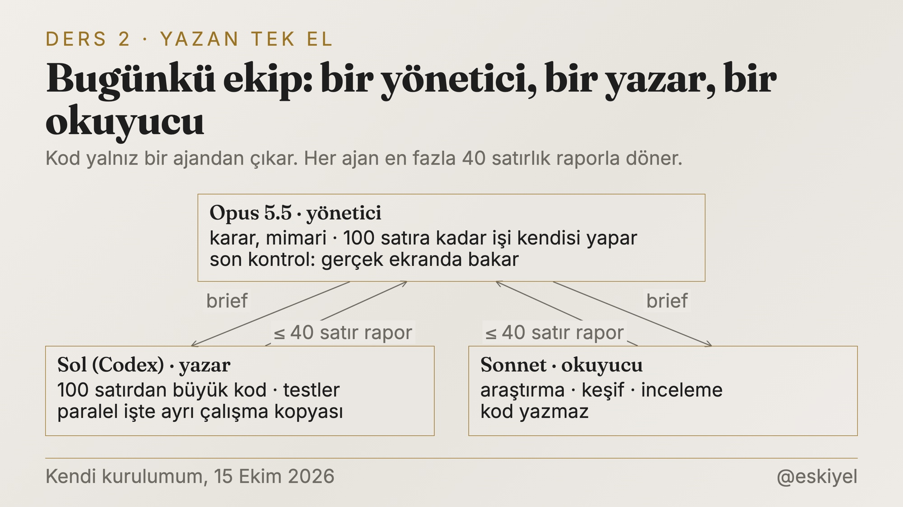
*Kod tek ajandan çıkıyor; okuyan ve inceleyen ayrı.*

Kodu yalnız Sol yazar, Sonnet kod yazmaz, okur. Opus karar verir ve sonucu kontrol eder. İki ajan aynı anda çalışacaksa her birinin ayrı bir çalışma kopyası olur, aynı dosyaya iki yazar girmez. Her ajan en fazla 40 satırlık bir raporla döner. Uzun dökümü dosyada bırakır, yönetici gerekirse oradan tek parça okur.

## 3. Context'i şişiren, suçladığım şey değilmiş

13 Ekim'de yöneticinin context'i her oturumda hızla doluyordu ve şunu yazdım: "Sırf azalsın diye orkestrasyon yapıyorum ama bu ters etki gibi bir şey oldu." Sezgim, işleri devretmenin yöneticiyi şişirdiği yönündeydi.

Ölçtürdüm. 89 oturum, 10.324 model çağrısı, 22,6 milyon token büyüme.

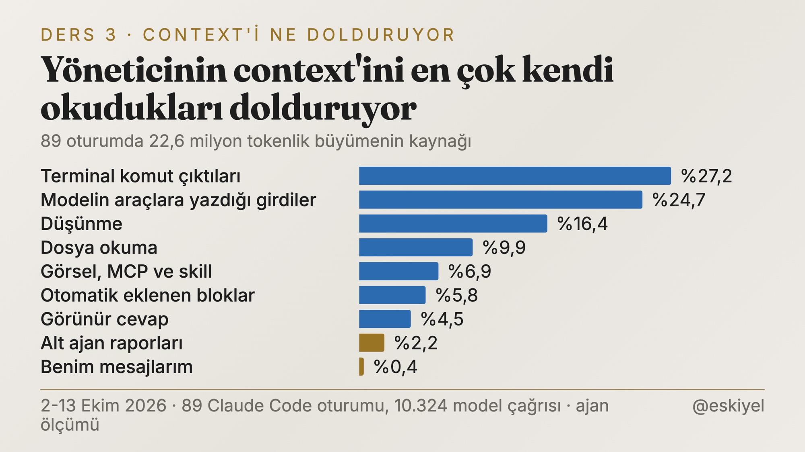
*Alt ajan raporları büyümenin yalnız %2,2'si; asıl yük yöneticinin kendi okudukları.*

Alt ajan raporları büyümenin yalnız %2,2'si. Orkestrasyonun bütün izi (brief, rapor, kontrol) %21-27 arasında ve devretmeye ağırlık verdiğim 10 Ekim'den önce ve sonra neredeyse aynı kalmış, %27,6 ve %26,3. Asıl sıçrama başka yerden geliyordu. İş devredilen turlarda bile yöneticinin kendi harcadığı token (dosya okuma, terminal çıktısı, düşünme) 24,7 binden 58,3 bine çıkmış. Yani yönetici işi veriyor, sonra yine kendisi okuyup kurcalıyor. (Orkestrasyon payı 63 oturumluk ayrı bir ölçümden, grafik 89 oturumdan.)

Benim mesajlarım ise %0,4. Context'i ben doldurmuyorum, ajanın kendi okudukları dolduruyor.

Bu yük bir de hızlanmıştı. 10 Ekim'den sonra bir tur, medyan olarak 7,9 bin tokenden 20,7 bin tokene çıktı. Context'in 200 bine varması 35 dakikadan 21 dakikaya indi. O günlerde üç şey birden değiştiği için sebebini tek bir şeye bağlayamıyorum.

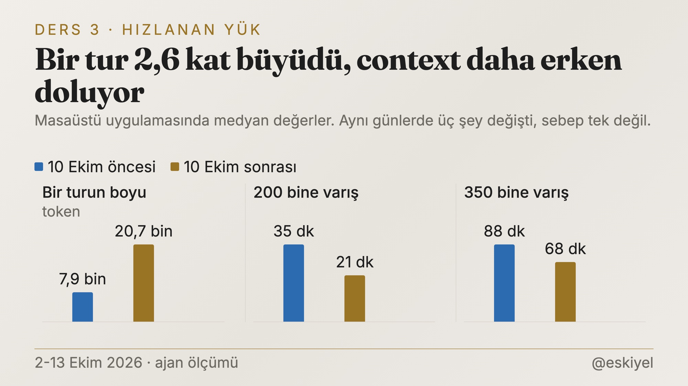
*10 Ekim'den sonra bir tur 2,6 kat büyüdü.*

Araştırma tarafı neden önemli olduğunu söylüyor. Cursor, sistemlerinin ölçeklenmesini paralellikten çok planlayıcının context'inin ayrıntıyla dolmamasına bağlıyor (kendileri bunu hipotez diye yazıyor). Boolean'ın küçük ölçümü daha ilginç. Opus 5, context'e ilgisiz 250 bin token doldurulunca başarısını koruyor, ama doldurulan metin işle ilgiliyse başarı %50'den %40'a düşüyor. Bir yöneticinin context'i de tam olarak işle ilgili malzemeyle dolar. Kod, log, test çıktısı.

Bunun üzerine 16 KB'den büyük bir dosyayı terminale döken komutu çalışmadan önce durduran küçük bir bekçi yazdırdım. 36 komutluk denemede yeni bekçi 36'sını da doğru yakaladı, eski kural 22'sini. Etkisini 27 Ekim'de aynı ölçümle göreceğim.

## 4. Yeşil test, doğru demek değil

30 Eylül'de iki kabul yöntemini karşılaştırdım. Birinde işi bağımsız bir ajan ayrıntılı kontrol ediyordu, ötekinde hafif bir kontrol vardı. Altı küçük ve birbirinden bağımsız Python komut satırı görevi, on iki taze oturum.

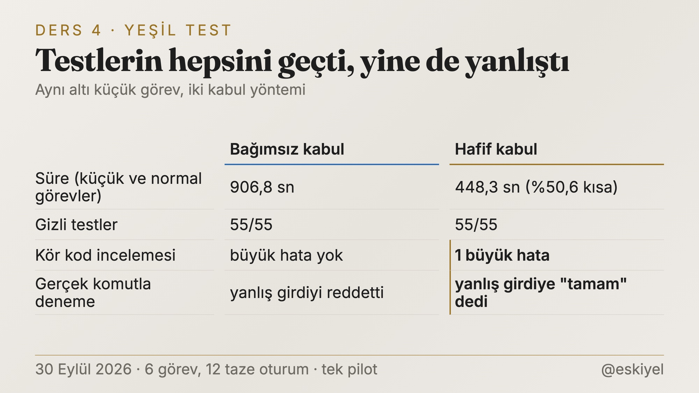
*Hafif kabul testlerin hepsini geçti, kör inceleme büyük bir hata buldu.*

Küçük ve normal görevlerde hafif yol yarı sürede bitti. Gizli testlerin de hepsini geçti. Sonra koda kör bir inceleme yaptırdık. Hafif yoldan geçen kodda büyük bir hata vardı. Kod, kaynakta 1 adet ürün varken 2 adet aktarmayı başarı sayıyordu. Testler bunu yakalamadı. Programı gerçek bir komutla çalıştırınca yanlış girdiye "tamam" dedi.

Aynı şeyi başka işlerde de gördüm. Bir işte 655 test yeşil yanıyordu. Kodu canlı veritabanının kopyasında çalıştırınca 2 hata çıktı. Testlerdeki sahte fonksiyon 2 alan döndürüyordu, gerçeği 3 alan. Bir başka işte Sonnet, Sol'un yazdığı kodda 12 kusur buldu, yeni açılan bir Sol oturumu 3 tane daha.

Araştırma tarafı bunu yıllardır söylüyor. ICLR 2024'te yayımlanan bir çalışmaya göre dil modelleri akıl yürütme görevlerinde dışarıdan bir geri bildirim olmadan kendi akıl yürütmesini düzeltmekte zorlanıyor, bazen düzeltirken bozuyor. Anthropic'in uzun süren uygulamalar üzerine yazısı daha açık. Ajanlardan kendi işlerini değerlendirmeleri istendiğinde, vasat işi bile kendinden emin biçimde övüyorlar, özellikle tasarım gibi öznel işlerde. Ayarlanmamış hâliyle Claude'un zayıf bir kalite kontrol ajanı olduğunu da yazıyorlar. Spotify'da kod ajanının işini bir yargıç model kontrol ediyor ve oturumların yaklaşık dörtte birini veto ediyor. Ama aynı yazıda yargıcın ne kadar doğru karar verdiğini henüz ölçmediklerini de yazıyorlar.

Çok ajanlı sistemlerin neden başarısız olduğunu inceleyen MAST çalışması (NeurIPS 2025, 1.642 iz) hataların %23,5'ini görev doğrulamasına bağlıyor.

Bende artık işi yazan onaylamıyor. Testlerden sonra programı gerçek giriş noktasından çalıştırıyorum. Komut satırı aracıysa komutla, sayfaysa tarayıcıda. "Testler geçti" cümlesini bir iddia olarak okuyorum.

## 5. "Bunu yapma" yazmak çalışmıyor, bekçi koymak çalışıyor

Bu dersi üç kez, birbirinden bağımsız üç yerde öğrendim.

Ağustos'ta context'i hızlı dolduran modele "az oku" diye bir kural yazdım. Kural yokken bir işte 16 araç çağrısı yapıyordu. Kuralla iki denemede 32 ve 18 çağrı yaptı, context'i de daha çok büyüdü. İki deneme az, ama kuralı kalıcı yapmadım.

13 Ekim'de Matt Pocock'un "yapıyor olabileceğiniz hatalar" listesiyle bütün kurulumumu denetlettim: 79 oturum, beş okuyucu ajan. Sonuç utandırıcıydı.

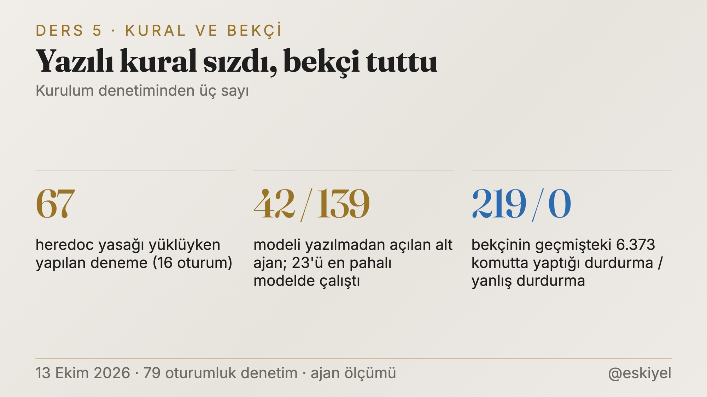
*Yazılı kural sızdı, komuttan önce çalışan bekçi tuttu.*

Kural dosyada yazılıydı, model her oturumda okuyordu ve yine de uymadı. Kuralı daha sert yazmayı denemedim. Komut çalışmadan hemen önce devreye giren küçük betikler (Claude Code'da hook deniyor) yazdırdım. Heredoc bekçisini geçmişteki 6.373 komut üzerinde denedik. 219 komutu durdururdu ve hepsi gerçekten kuralı çiğneyen komutlardı. İlk taslağı 16 masum komutu da durduruyordu, bunu kuru koşu yakaladı.

Sınırlar da aynı şekilde çalışıyor. "Raporun en fazla 40 satır olsun" dediğimde Codex işlerinin 45'inde 45'i uydu. Dört araştırma ajanı ise 40 satırı çok uzun satırlarla 4-5 bin tokene şişirdi. Onlara kelime sınırı verince uydular. Ölçülebilen ve kaçamağı olmayan sınır tutuyor.

Araştırma da aynı yeri gösteriyor. Anthropic'in harness yazısında sevdiğim bir cümle var. Bir harness'taki her parça, modelin kendi başına yapamadığı bir şey hakkında bir varsayım taşır. MAST'a göre çok ajanlı sistem hatalarının %44,2'si sistem tasarımından geliyor. Microsoft'un Azure SRE ekibi 100'den fazla araç ve 50'den fazla uzman ajanla başlamış, 5 temel araç ve bir avuç genelci ajanla bitirmiş. Bir de dörtten fazla devir gerektiren sorunlar neredeyse her zaman başarısız olduğunu yazmışlar.

Bir düzeltmeyi ikinci kez yapıyorsam, üçüncüsü için bekçi yazdırıyorum. Metin kuralları yalnız muhakeme gerektiren işlere kalıyor.

## 6. Ucuz model bedava değil, ve modeli çoğu zaman para seçiyor

Model seçimi bende çoğu zaman kalite kararı olmadı, plan kararı oldu.

7 Ekim'de Sol'u ücretsiz planda kullanamıyordum ve 20 dolarlık aboneliği yenilemek istemedim. Elimde 62,5 bin kredi vardı. İşçi olarak Codex'in daha ucuz modeli Luna'ya geçtim. Aynı gün zor bir kod görevinde Luna'yı Sonnet'le yarıştırdım. İkisi de 35 gizli testin 35'ini geçti, aralarında fark yoktu. Luna 2 dakikada bitirdi ve kredi harcamadı, Sonnet 3 dakikada ve yaklaşık 74 bin tokenle.

Ertesi gün aboneliği yeniledim. 9 Ekim'de Luna ile Sol'a aynı altı tuzaklı web araştırma sorusunu sordum.

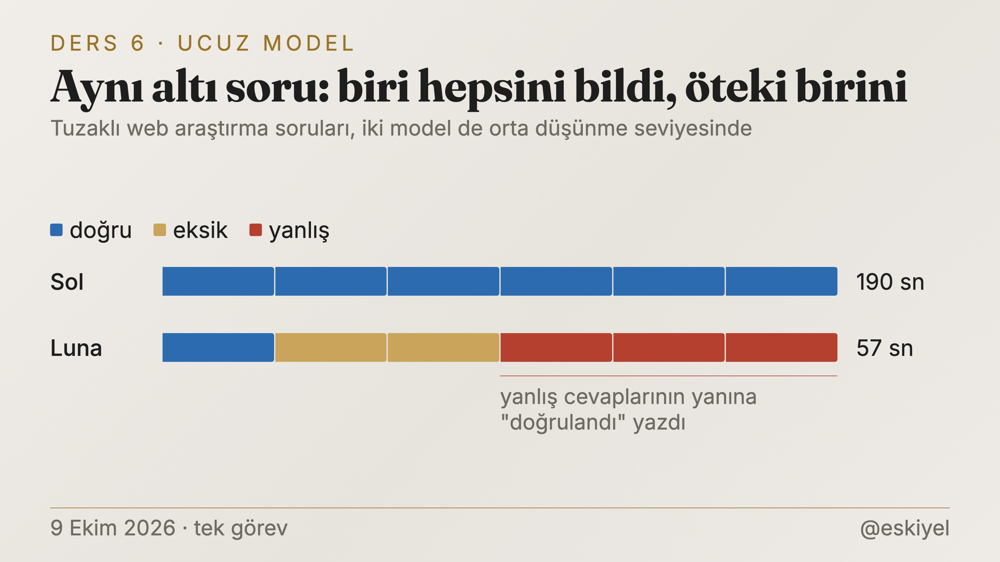
*Ucuz model kodda yetti, araştırmada altı sorunun birini bildi.*

Luna üç kat hızlıydı ve altı sorunun birini doğru bildi. Beni asıl korkutan, yanlış cevaplarının yanına "doğrulandı" yazmasıydı. Kodda yanlışı test yakalıyor. Araştırmada yanlışı ancak kontrol eden biri yakalıyor, ve "doğrulandı" etiketi tam da o kontrolü atlattırıyor. Aynı gün Luna'yı ekipten tamamen çıkardım. Bu testlerin her biri tek görevlik, genelleme yapmıyorum. Ama kolay geri alınabilen bir karar için yetti.

Araştırma tarafında en temiz örnek Fresh Worktree adlı bağımsız bir blogdan. Aynı görevde düz bir Opus koşusu, ucuz işçiye iş devreden orkestrasyonları her ölçüde geçmiş. Düz Opus medyan 13 dolar ve 30 dakikada bitirmiş. İşi daha ucuz bir işçiye devreden kurulumlar 15-18 dolar ve 52-64 dakika tutmuş. Ucuz işçi yazma maliyetini düşürmüş, ama inceleme ve düzeltme turları kazancı yemiş. Her biri 3 koşuluk küçük bir deney, ama yönü benim gördüğümle aynı. Cursor'ın tablosu öteki ucu gösteriyor. Pahalı bir planlayıcı ile ucuz işçinin karışımı 1.339 dolara mal olmuş, her rolü GPT-5.5'e verince 10.565 dolar. (Cursor ucuz işçiyi, yani kendi modelini sattığı için bu rakamı ihtiyatla okumak lazım.)

Ben artık ucuz modeli sonucu kolay doğrulanan işe veriyorum. Araştırma ve karar gibi doğrulaması zor işler iyi modele gidiyor.

## 7. Ölçümün de ölçülmesi gerekiyor

Bu yazıdaki sayıların çoğunu ajanlar üretti. O yüzden en çok bu dersi önemsiyorum.

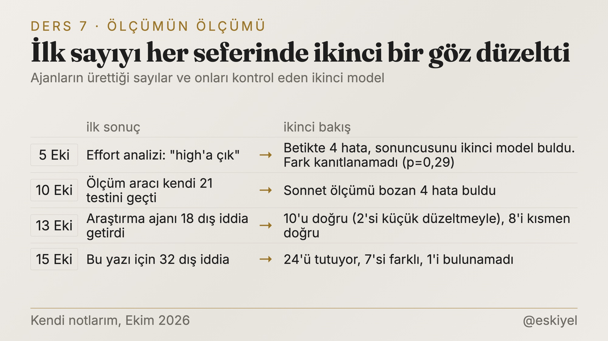
*Dört ölçümün dördünde de ilk sayıyı ikinci bir bakış düzeltti.*

5 Ekim'de Claude bana Opus'u "high" düşünme seviyesine çıkarmamı önerdi. Dayandığı analiz betiğinde dört hata vardı. Araç hataları hep sıfır sayılıyordu, alt ajan dosyaları ayrı oturum sayılıyordu, bazı token'lar iki kez sayılıyordu. Sonuncusunu bağımsız ikinci bir model buldu. Düzeltilmiş veride iki seviye arasında anlamlı bir fark çıkmadı.

13 Ekim'de yönetici ile Codex arasına bir ara ajan koymayı denedim. Tek koşuluk A/B testinde yöneticinin context büyümesi 27.853 tokenden 16.777'ye indi, %40 azaldı. Kâğıt üstünde harikaydı. Ama o koşuda üç şey birden değişmişti ve kazancın yaklaşık yarısı bir skill dosyasının yüklenmemesinden geliyordu. Dışarıda bu yöntemi kullanan birini de bulamadık. Reddettim.

Araştırmalarda da aynı sorun var. MAST hakemli bir çalışma ve doğrulama adımı eklemenin başarıyı 15,6 puan artırdığını yazıyor. Ama bu sonuç 32 görevlik bir kümeden çıkıyor. 15,6 puan, 5 görevlik fark demek. Yazarlar kendileri de bu kazancın büyük bir iyileşme sayılmayacağını söylüyor. Cross-Context Review adlı bir çalışmanın yazarı da ikinci sürümde ilk sürümdeki bir iddiasını geri çekmiş, çünkü iddia tek bir koşudan geliyormuş.

Artık tek koşuluk bir sonuca büyük bir karar bağlamıyorum. Luna'yı çıkarmak gibi kolay geri alınan bir kararda tek test yetebiliyor, düzeni değiştirecek bir kararda yetmiyor. İlk sayıyı her zaman ikinci bir göz okuyor, mümkünse başka bir modelden.

## Hepsinin altındaki ders: aşırı mühendislik

Yedi dersin hepsinde aynı tuzak var ve ben ona iki kez düştüm.

10 Ekim'de Codex'e verdiğim işlerin kalitesini ölçmek için bir test düzeni kurdurdum. 12 tuzaklı görev vardı ve her biri 3 kez koştu. Tuzaklar, ajanların teslim ettiği işlere yaptığım 293 gerçek düzeltme şikâyetinden türetildi. Sonra işçiye verilen talimata üç farklı ek denedik.

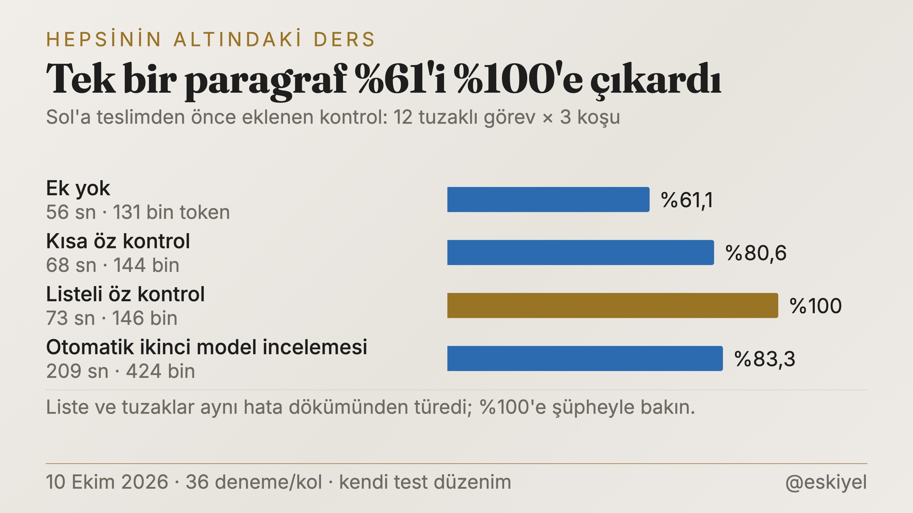
*Teslimden önce eklenen tek bir öz kontrol listesi temiz teslimi %61'den %100'e çıkardı.*

Teslimden önce "şu listeyi kendin kontrol et" diyen tek bir paragraf, temiz teslim oranını %61'den %100'e çıkardı. Pahalı olan otomatik ikinci model incelemesi ise listeli öz kontrolden kötü sonuç verdi ve üç kat token harcadı. %100'e biraz şüpheyle bakmak lazım, çünkü liste ile tuzaklar aynı hata dökümünden çıktı. Sınav sorularını önceden bilmeye benziyor. Ama kazancın yarısı listeden bağımsızdı. İşçiye yalnız "brief'in ötesini düşün, çevredeki kodu oku" demek bile oranı %81'e çıkardı.

Paragrafı kurduk. İki saat sonra bütün sistemi rafa kaldırdım. O gece şunu yazmışım: "bu bench çok uzun sürüyor ... çok aşırı mühendisliğe kaçıyormuşuz gibi geliyor. Olabilecek en basic şekilde kullanmalıyız." Sistemi bırakmak bence doğruydu. Ama o tek paragraf da sistemle birlikte gitti ve bunu ancak üç gün sonra, bir denetimde bir ajan fark etti. Basitleştirirken ölçülmüş iyi bir parçayı da atmışım.

13 Ekim gecesi aynı şeyi bir kez daha yaşadım ve kendime şunu yazdım: "çok yanlış yollara girdik, çok fazla açıldık."

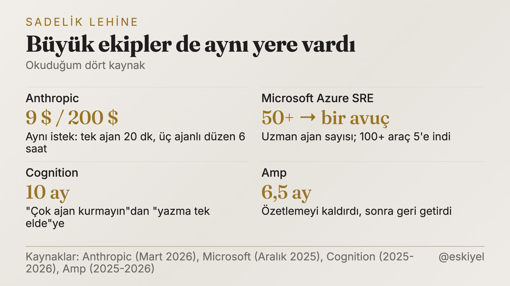
*Büyük şirketler de karmaşık düzenlerden sadeye döndü.*

Bu konuda yalnız değilim. Anthropic aynı tek cümlelik uygulama isteğini iki yolla denemiş. Tek ajan 20 dakikada 9 dolara bitirmiş, planlayıcı, üretici ve değerlendiriciden oluşan ekip 6 saatte 200 dolara. Ekibin sonucu daha zengin çıkmış, ama bir sonraki model kuşağında bu yapının bir kısmını söküp atmışlar. Amp, Ekim 2025'te özetleme özelliğini kaldırıp yerine başka bir yöntem koymuş, altı buçuk ay sonra geri getirmiş. Anthropic 2024 sonunda en basit çözümü bulmayı, karmaşıklığı yalnız gerektiğinde artırmayı tavsiye ediyordu. Bence hâlâ en iyi tavsiye bu.

## Ekibimin bana sorduğu sorular

Ekip de bana soru soruyor. Bunu da ölçtürdüm.

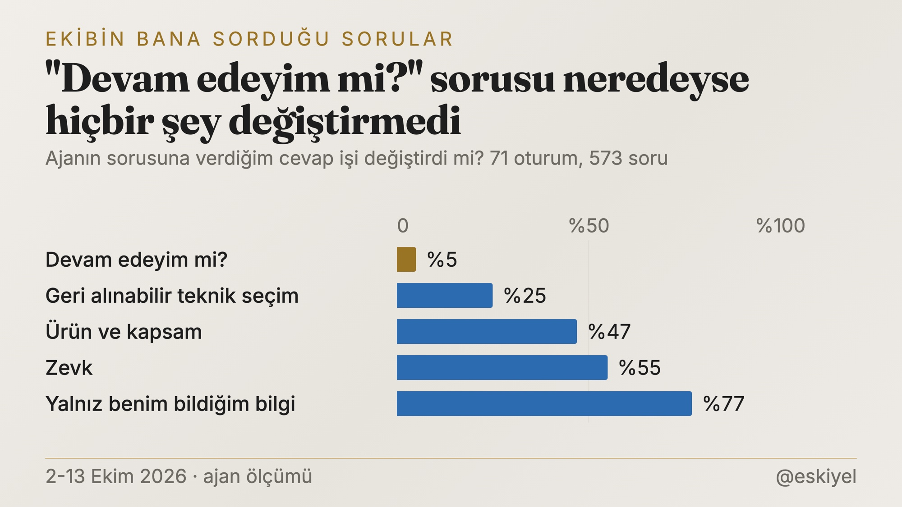
*"Devam edeyim mi" sorularına verdiğim cevap işi yalnız %5 oranda değiştirdi.*

71 oturumda ajanlar bana 573 soru sormuş. Her 100 cevabın 27'si soruyla bitiyordu. Cevabımın bir şeyi gerçekten değiştirip değiştirmediğine baktırdım. "Devam edeyim mi" sorularında cevabım yalnız %5 oranda bir şey değiştirmiş. Yani o soruların çoğu gereksizmiş. Yalnız benim bildiğim bir bilgi sorulduğunda oran %77'ye çıkıyor.

Kuralı buna göre yazdım. Teknik ve geri alınabilir kararı ajan kendisi veriyor. Ürün, kapsam, zevk ve geri dönüşü olmayan işler bana geliyor. 27 Ekim'de aynı ölçümü tekrarlatacağım. Hedef 100 cevapta 15 sorunun altı.

## Bugün nereden başlardım

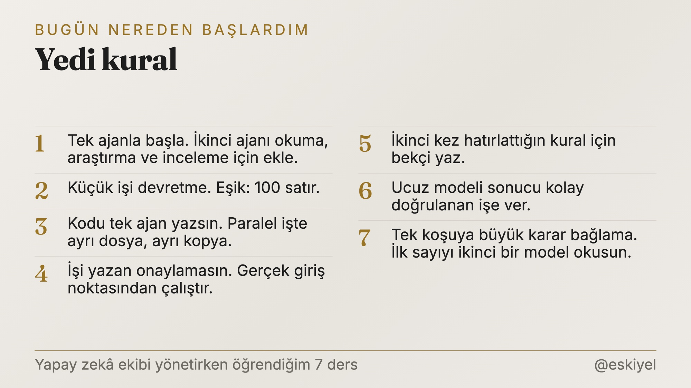
*Bugün sıfırdan başlasam uyacağım yedi kural.*

Sıfırdan bir yapay zekâ ekibi kuracak olsaydım:

1. Tek ajanla başlardım. İkinci ajanı yalnız okuma, araştırma ya da inceleme için eklerdim.
2. Küçük işi devretmezdim. Bende eşik 100 satır.
3. Kodu tek bir ajan yazardı. Paralel işte her yazara ayrı dosya ve ayrı çalışma kopyası verirdim.
4. İşi yazana onaylatmazdım. Testten sonra programı gerçek giriş noktasından çalıştırırdım.
5. Bir kuralı ikinci kez hatırlatıyorsam, metin yerine bekçi yazardım.
6. Ucuz modeli sonucu kolay doğrulanan işe verirdim.
7. Tek koşuya karar bağlamazdım. İlk sayıyı ikinci bir modele okuturdum.

Bu yazının kendisi de bu düzenle çıktı. Üç okuyucu ajan, biri benim notlarımı, biri araştırmaları, biri X'in makale biçimini taradı. Biri de 32 dış iddiayı asıl kaynağında açtı. Kararları, seçimi ve yazıyı yönetici model ile ben yaptık. 27 Ekim'deki ölçümler gelince sonuçları buraya yazarım. Rakamlar iyi çıksa da kötü çıksa da.

Not: Bu yazıyı Eskiyel yazmadı. Kendi notlarımı tutan başka bir yapay zekâyla birlikte, iki aylık kayıtlarımdan çıkardık.

## Kaynaklar

- Anthropic, çok ajanlı araştırma sistemi (13 Haziran 2025): https://www.anthropic.com/engineering/multi-agent-research-system
- Anthropic, Claude Opus 5.5 sistem kartı, bölüm 8.12 (22 Eylül 2026)
- Anthropic, uzun süren uygulamalar için harness tasarımı (24 Mart 2026): https://www.anthropic.com/engineering/harness-design-long-running-apps
- Anthropic, C derleyicisi (5 Şubat 2026): https://www.anthropic.com/engineering/building-c-compiler
- Anthropic, Building Effective Agents (19 Aralık 2024): https://www.anthropic.com/research/building-effective-agents
- Cognition (12 Haziran 2025): https://cognition.com/blog/dont-build-multi-agents
- Cognition (22 Nisan 2026): https://cognition.com/blog/multi-agents-working
- Cursor (20 Temmuz 2026): https://cursor.com/blog/agent-swarm-model-economics
- Every, Codex'e iş devretme notları (1 Nisan 2026): https://github.com/EveryInc/compound-engineering-plugin/blob/main/docs/solutions/best-practices/codex-delegation-best-practices.md
- Boolean (15 Eylül 2026): https://www.boolean.ai/blog/context-rot-quantified
- Huang ve diğerleri, ICLR 2024: https://arxiv.org/abs/2310.01798
- MAST, NeurIPS 2025: https://arxiv.org/abs/2503.13657
- Cross-Context Review, v2 (1 Ekim 2026): https://arxiv.org/abs/2603.12123
- Spotify Engineering (Aralık 2025): https://engineering.atspotify.com/2025/12/feedback-loops-background-coding-agents-part-3
- Microsoft Azure SRE Agent (26 Aralık 2025): https://techcommunity.microsoft.com/blog/appsonazureblog/context-engineering-lessons-from-building-azure-sre-agent/4481200
- Amp (23 Ekim 2025 ve 6 Mayıs 2026): https://ampcode.com/news/handoff · https://ampcode.com/news/neo
- Fresh Worktree (9 Ağustos 2026): https://fresh-worktree.ghost.io/is-luna-on-max-effort-the-solution-to-coding-cost/
